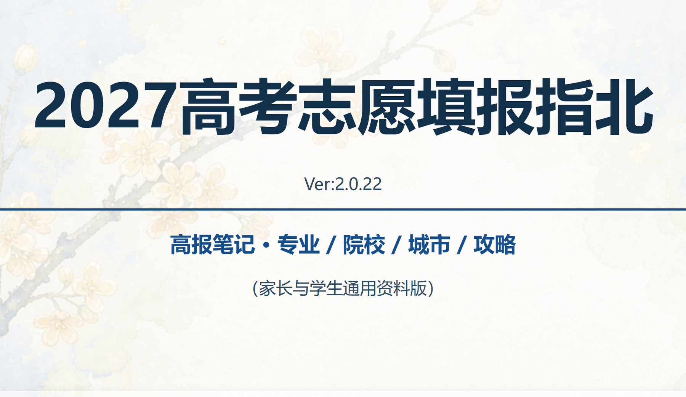

<h1 align="center">📖 2027高考志愿填报指北</h1>

> 🎓 <a href="https://jackiezheng.github.io/gaokao-2027-guide/" target="_blank" rel="noopener noreferrer">《2027高考志愿填报指南》</a> 的姊妹篇 —— 指南讲方法，指北给资料。

《2027高考志愿填报指北》是「高报笔记」全库的原文汇编：把笔者（雪人老师）日常的文章及笔记，按分类完整汇编成一本可检索、可打印的书，分享给粉丝家长和同业老师，希望对您有所帮助。全书是一个单页 HTML，左侧导航可逐层级折叠，点击直达任一篇。

## 📐 全书规模

| 篇章 | 篇数 | 编排 |
|---|---|---|
| 🧑‍🎓 第一篇 专业篇 | 261 | 按学科门类 → 专业类 → 专业三级编排 |
| 🏫 第二篇 院校篇 | 348 | 按院校所在省级行政区分组 |
| 🏙️ 第三篇 城市篇 | 52 | 城市笔记，按原目录顺序平铺 |
| 🧭 第四篇 攻略篇 | 133 | 志愿填报专题攻略 |
| 📗 附录 | 1 | 高报词条：通用术语、招生类型、志愿填报机制、院校联盟与特殊班型 |

合计 **794 篇笔记 / 364.3 万字**（万字按正文汉字数统计），另含封面、目录、篇章扉页与致谢。全书目录 933 条，逐篇顺序与《笔记目录索引》一致。

## 🗂️ 目录层级

- 🧑‍🎓 **专业篇**：篇章 → 学科门类 → 专业类 → 篇名（四级），门类与专业类分开编排；
- 🏫 **院校篇**：篇章 → 省级行政区 → 篇名（三级）；
- 🏙️ **城市篇 / 攻略篇**：篇章 → 篇名（两级），按原目录顺序平铺。

每篇笔记的标题居中，正文保留原有的标题、段落、表格、列表与脚注释义；篇数统计以小字括注挂在篇章与分类标题后，便于按门类、省份、城市与专题检索。

## 🧭 阅读方式

- 🌐 **在线阅读**：<a href="https://jackiezheng.github.io/gaokao-2027-notes/" target="_blank" rel="noopener noreferrer">https://jackiezheng.github.io/gaokao-2027-notes/</a>
- 🗂️ 左侧「指北导航」默认只显示一级条目，点 `▸` 逐层展开，可「全部展开 / 全部折叠」，展开状态记在浏览器本地；
- 🔗 目录与导航中的每一条都能点击直达；`Ctrl/Cmd + B` 或 `Esc` 开关导航面板；点击任一层级，地址栏同步到该篇，浏览器标签页标题按「当前篇 - … - 一级 - 书名」显示层级链，便于收藏与分享；
- ⏮️ 正文底部有「上一篇 / 当前篇 / 下一篇」翻篇导航条：按全书 927 条目录顺序（封面 → 编撰说明 → 目录 → 第一篇专业篇 → … → 各篇）在相邻条目间跳转，「当前篇」圆钮回到当前篇开头，三个按钮带悬停提示；
- 🧰 页面右侧从上到下一列功能浮钮：
  - 🎨 **阅读设置**（最上）：可调阅读体验——**字号**共 10 档（9.4pt～21.5pt，按钮直接显示实际字号），**只作用于封面之后、落款之前（含）**的阅读区——目录、章节、正文、注释、特别感谢与致谢同步缩放，封面与落款之后、各类浮层界面字号不变；**字体**共 12 款（系统 + 楷书、行书、黑体、文楷等），**应用到全站**正文与导航；**风格**共 5 款（默认 / 夜间 / 护眼 / 素笺 / 青瓷）；选择记在浏览器本地；字体按需空闲下载，下载时面板内显示进度、完成后气泡提示；面板右上角「重置」可一键把风格、字号、字体全部恢复默认；
  - 🔍 **全文搜索**：`Ctrl/Cmd+F` 或点击右上角搜索图标打开；支持多个关键词（空格分隔、或关系），**未加载的笔记也能搜到**；点击结果直达命中段落，把每个关键词都标出来（命中词即使是书中原有重点词 / 院校专业名，也会叠加暖黄底色），上次搜索词自动回填；面板展开时搜索图标自动隐藏、收回时恢复；
  - 📤 **分享本页**：一键复制当前页面的链接（浏览器地址栏地址），弹出「复制成功」提示；
  - 📝 **阅读记录**：打开阅读记录面板，列出阅读历史与上次位置；页面加载后若检测到上次阅读位置，会弹「继续上次阅读？」提醒，可一键跳回；面板右上角「清空」可一键清空全部阅读历史；
  - 🗣️ **语音朗读**：点击右侧「语音朗读」按钮，可把当前篇全文朗读出来——**语速** 5 档（0.5×～1.5×，默认 1.0×）、**音色**按设备可用的中文语音列出（有男声康康则默认选它，保证默认男声）、**从光标处朗读**、**连续朗读下一篇**可选；朗读时出现快捷播放控制条（播放/暂停、上一条/下一条、静音、音量、进度），可随时暂停、继续或停止；⚠️ **浏览器支持说明**：语音朗读依赖浏览器的 Web Speech API（`speechSynthesis`），**部分浏览器或设备可能不支持或没有中文音色**——不支持时按钮会禁用并气泡提示「当前浏览器不支持语音朗读」，没有可用中文音色时会弹出安装引导；音色列表随设备不同而变化属正常现象，建议用 Chrome / Edge 最新版体验最佳；
  - ⬆️ **回到顶部**（右侧靠下）：一键平滑滚动返回页首；滚动离开页首时显示，回到页首自动隐藏；
  - 💬 **问题反馈**（最下）：电脑端点击新窗口打开反馈页；微信 / 手机端会弹出可复制的微信号与反馈链接卡片，卡片里另有「反馈」按钮可直接打开链接（移动端常显提示 5 秒后自动关闭，也可手动关闭），避免外链被拦截后无法联系；
- 🖥️ **「清屏」**：单击页面空白处，隐藏 / 显示桌面功能图标（左侧导航折叠按钮 + 右侧全部功能浮钮）；再单击一次恢复；点击按钮、链接、输入框、面板等交互元素不会触发。

## 🔗 关联项目

本书的姊妹篇是 <a href="https://jackiezheng.github.io/gaokao-2027-guide/" target="_blank" rel="noopener noreferrer">《2027高考志愿填报指南》</a>（仓库 <a href="https://github.com/JackieZheng/gaokao-2027-guide" target="_blank" rel="noopener noreferrer">JackieZheng/gaokao-2027-guide</a>）。

**指南讲方法，指北给资料**：《指南》是方法论手册，本册是资料汇编，两册主色调一绿一蓝配套使用：先用指南建立框架，再用指北查具体学校、专业与城市。笔记为日常资料整理，原有表述、年份与数据一律保留，涉及招生政策、批次、志愿数量与录取数据的部分，请结合当年各省教育考试院官方公告判断时效性。

---

时间仓促，才疏学浅，如有遗误，万望指正，不胜感谢。

雪人 二〇二六年十一月　于天津

---

## 📜 许可协议

本项目采用 <a href="https://creativecommons.org/licenses/by-nc/4.0/" target="_blank" rel="noopener noreferrer">知识共享 署名-非商业性使用 4.0 国际（CC BY-NC 4.0）</a> 许可。

- ✅ **可分发**：允许转载、分享、公开传播
- ✅ **可修改**：允许改编、整理、再创作
- ❌ **不可商用**：不得用于商业出版及其它商业用途
- 📌 **须署名**：使用时须注明原作者（雪人老师）及来源，并保留本许可说明

完整法律文本见仓库根目录 <a href="./LICENSE" target="_blank" rel="noopener noreferrer">LICENSE</a>。

---

## ☕ 赞赏

若这本小书对您有帮助，欢迎扫码赞助一杯咖啡。

