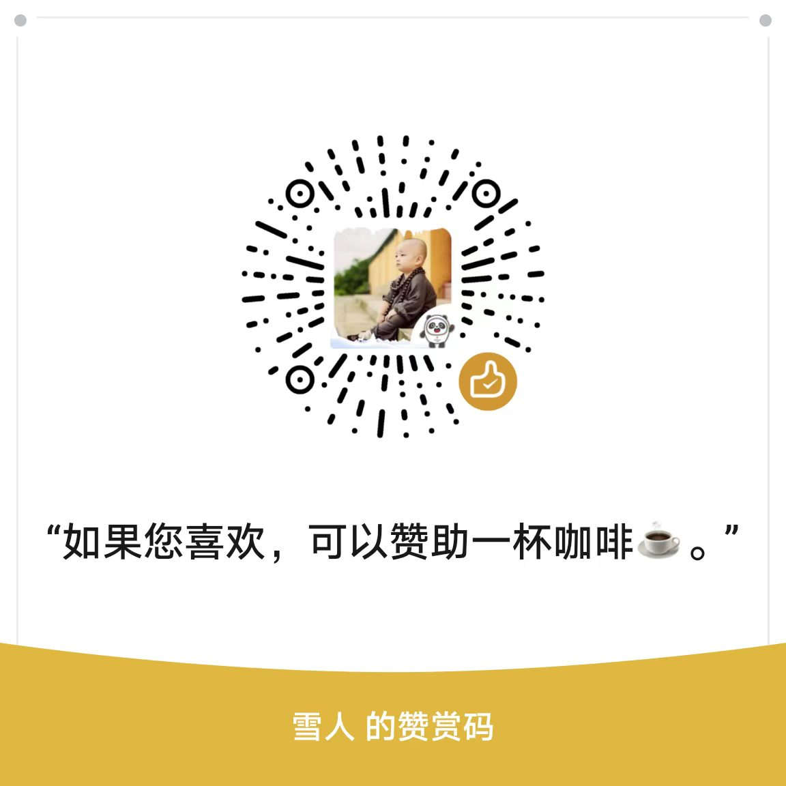

# 2027高考志愿填报指北

> <a href="https://jackiezheng.github.io/gaokao-2027-guide/" target="_blank" rel="noopener noreferrer">《2027高考志愿填报指南》</a> 的姊妹篇 —— 指南讲方法，指北给资料。

《2027高考志愿填报指北》是「高报笔记」全库的原文汇编：把笔者（雪人老师）日常的文章及笔记，按分类完整汇编成一本可检索、可打印的书，分享给粉丝家长和同业老师，希望对您有所帮助。全书是一个单页 HTML，左侧导航可逐层级折叠，点击直达任一篇；用浏览器直接打印，即可得到带页眉页码的 A4 版本。

## 全书规模

| 篇章 | 篇数 | 编排 |
|---|---|---|
| 第一篇 专业篇 | 252 | 按学科门类 → 专业类 → 专业三级编排 |
| 第二篇 院校篇 | 341 | 按院校所在省级行政区分组 |
| 第三篇 城市篇 | 51 | 城市笔记，按原目录顺序平铺 |
| 第四篇 攻略篇 | 73 | 志愿填报专题攻略 |
| 附录 | 1 | 高报词条：通用术语、招生类型、志愿填报机制、院校联盟与特殊班型 |

合计 **717 篇笔记 / 311.4 万字**（万字按正文汉字数统计），另含封面、目录、篇章扉页与致谢。全书目录 855 条，逐篇顺序与《笔记目录索引》一致。

## 目录层级

- **专业篇**：篇章 → 学科门类 → 专业类 → 篇名（四级），门类与专业类分开编排；
- **院校篇**：篇章 → 省级行政区 → 篇名（三级）；
- **城市篇 / 攻略篇**：篇章 → 篇名（两级），按原目录顺序平铺。

每篇笔记的标题居中，正文保留原有的标题、段落、表格、列表与脚注释义；篇数统计以小字括注挂在篇章与分类标题后，便于按门类、省份、城市与专题检索。

## 阅读方式

- **在线阅读**：<https://jackiezheng.github.io/gaokao-2027-notes/>
- 左侧「指北导航」默认只显示一级条目，点 `▸` 逐层展开，可「全部展开 / 全部折叠」，展开状态记在浏览器本地；
- 目录与导航中的每一条都能点击直达；`Ctrl/Cmd + B` 或 `Esc` 开关导航面板；
- 右上角「全文搜索」支持多个关键词（空格分隔、或关系），**未加载的笔记也能搜到**；点击结果直达命中段落，把每个关键词都标出来（命中词即使是书中原有重点词 / 院校专业名，也会叠加暖黄底色），上次搜索词自动回填；面板展开时搜索图标自动隐藏、收回时恢复；
- 点击目录 / 导航 / 搜索结果中的任一层级，地址栏同步到该篇，浏览器标签页标题按「当前篇 - … - 一级 - 书名」显示层级链，便于收藏与分享；右下角「回顶部」圆钮一键返回页首；
- 右下角「问题反馈」：电脑端点击新窗口打开反馈页；微信 / 手机端会弹出可复制的微信号与反馈链接卡片，卡片里另有「反馈」按钮可直接打开链接（移动端常显提示 10 秒后自动关闭，也可手动关闭），避免外链被拦截后无法联系；
- 网页版自带 A4 打印样式，打印时导航面板、搜索面板与反馈卡片自动隐藏。

## 关联项目

本书的姊妹篇是 <a href="https://jackiezheng.github.io/gaokao-2027-guide/" target="_blank" rel="noopener noreferrer">《2027高考志愿填报指南》</a>（仓库 [JackieZheng/gaokao-2027-guide](https://github.com/JackieZheng/gaokao-2027-guide)）。

**指南讲方法，指北给资料**：《指南》是方法论手册，本册是资料汇编，两册一绿一蓝配套使用：先用指南建立框架，再用指北查具体学校、专业与城市。笔记为日常资料整理，原有表述、年份与数据一律保留，涉及招生政策、批次、志愿数量与录取数据的部分，请结合当年各省教育考试院官方公告判断时效性。

---

时间仓促，才疏学浅，如有遗误，万望指正，不胜感谢。

                                    雪人
                          二〇二六年十一月  于天津

---

## 许可协议

本项目采用 [知识共享 署名-非商业性使用 4.0 国际（CC BY-NC 4.0）](https://creativecommons.org/licenses/by-nc/4.0/) 许可。

- ✅ **可分发**：允许转载、分享、公开传播
- ✅ **可修改**：允许改编、整理、再创作
- ❌ **不可商用**：不得用于商业出版及其它商业用途
- 📌 **须署名**：使用时须注明原作者（雪人老师）及来源，并保留本许可说明

完整法律文本见仓库根目录 [LICENSE](./LICENSE)。

---

## 赞赏

若这本小书对您有帮助，欢迎扫码赞助一杯咖啡。

网页版左侧「指北导航」顶部另有「☕ 赞赏作者」入口，可直接跳到全书末尾；长文档加载未完成时点击，页面会在加载完成后自动补滚。
